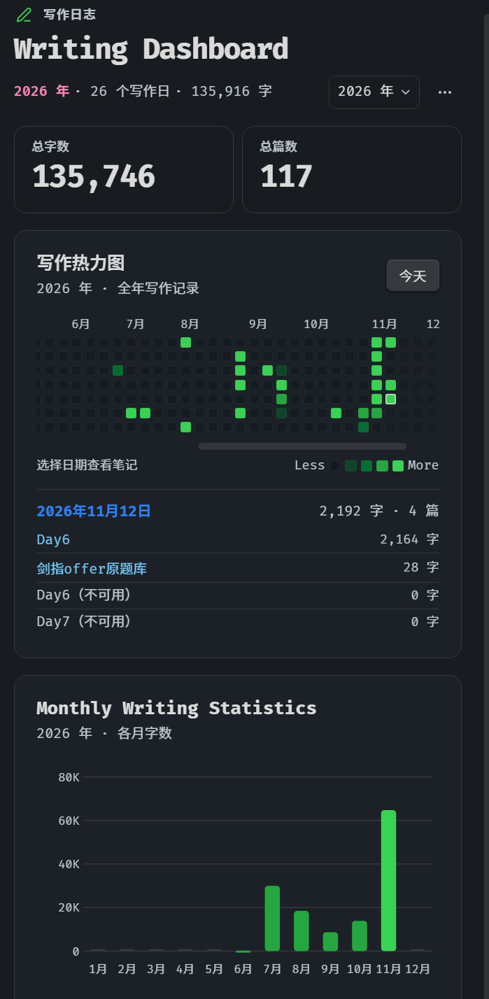
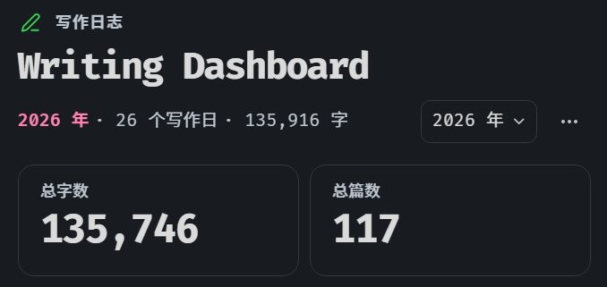
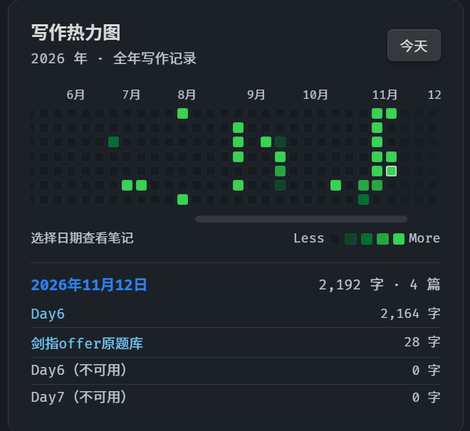
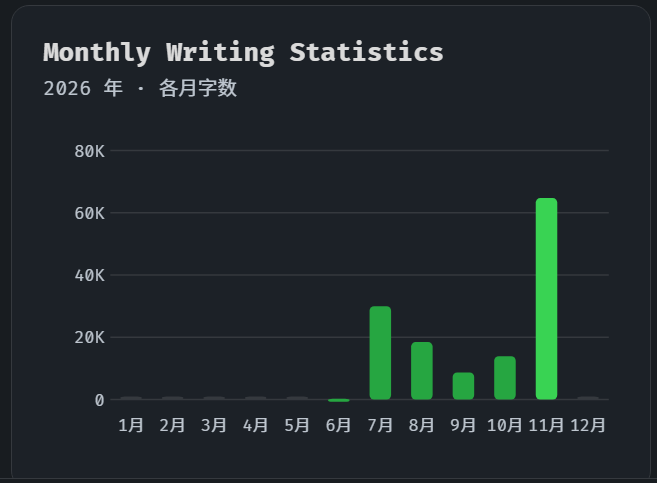

# Writing Dashboard

**在 Obsidian 右侧栏查看写作活动、字数趋势和每天写过的笔记。**

[下载最新版](https://github.com/Ckxkx/writing-dashboard/releases/latest) · [版本记录](CHANGELOG.md) · [反馈问题](https://github.com/Ckxkx/writing-dashboard/issues)



## 功能

- **年度概览**：切换年份查看写作天数和累计字数；顶部卡片始终显示当前 Vault 的总字数和 Markdown 笔记总篇数。
- **写作热力图**：打开时定位到今天。悬停查看统计，点击日期查看当日笔记，也可用方向键和 Enter 浏览。
- **月度趋势**：查看所选年份各月累计计入的字数。
- **实时统计**：输入时更新界面，Obsidian 保存后确认记录。桌面状态栏显示今日篇数和字数，点击可展开或收起右侧仪表盘。
- **本地运行**：支持按文件或目录排除、调整热力图阈值、暂停追踪和重建索引。无需账户，插件不上传笔记或写作数据。

<details>
<summary>查看功能细节截图</summary>

| 年度概览 | 日期与笔记详情 |
| --- | --- |
|  |  |
| **月度趋势** | **桌面状态栏** |
|  |  |

</details>

## 安装与升级

需要 **Obsidian 1.8.7 或更新版本**。目前通过 GitHub Releases 手动安装。

1. 从 [Releases](https://github.com/Ckxkx/writing-dashboard/releases/latest) 下载 `writing-dashboard-<版本>.zip`。
2. 将压缩包内的 `writing-dashboard` 文件夹解压到 `<Vault>/.obsidian/plugins/`。如果 Vault 使用自定义配置目录，请将 `.obsidian` 替换为实际目录。
3. 在 Obsidian 的 **设置 → 第三方插件** 中允许第三方插件，并启用 **Writing Dashboard**。若列表未刷新，重启 Obsidian。
4. 点击底部的今日统计、左侧折线图图标，或运行命令 **Open Writing Dashboard**。

也可以分别下载 `main.js`、`manifest.json` 和 `styles.css`，放入同一个插件目录。**升级时覆盖这些文件，保留现有的 `data.json`。**

## 统计口径

| 指标 | 如何计算 |
| --- | --- |
| 总字数 / 总篇数 | 当前纳入统计的 Markdown 笔记正文长度及笔记数量。删除文字会减少总字数；读取失败或超过计数上限的笔记不贡献字数。 |
| 每日和每月字数 | 启用前的已有正文通过索引计入笔记日期；之后可确认的新增内容计入本地编辑日期。删除内容不会扣减已经确认的新增记录，因此累计字数可能与当前总字数不同。 |
| 每日篇数 / 写作天数 | 同一天同一篇笔记只计一次。当天有正数计入字数时，计为一个写作日。 |

汉字逐字计数，英文等非汉字文本按单词计数，连续数字串计为一个单位。Markdown 标记不计入，标题、列表、表格、引用和链接文字等正文会计入。默认不计 YAML、代码块、行内代码、图片与嵌入。设置可开启 YAML 和代码块计数，行内代码始终不计。

首次启用会建立索引。旧笔记优先使用**文件创建时间**；缺失、无效或在未来时，才使用 YAML 的 `created` 属性，例如 `created: 2026-11-08`。两者都无效时，该笔记仍纳入总量，但不放进时间线。复制或迁移可能改变文件创建时间，索引无法还原安装前逐日的真实写作量。

遗漏笔记或调整计数范围后，可用右上角 **··· → 重建索引**，也可运行命令 **重建写作索引**。重建保留已追踪的活动。连续保存只确认一次相同内容；难以区分的跨午夜改动、超出差异预算的改写会标记为未完整计量。

## 数据与隐私

设置和统计保存在 Vault 的 `.obsidian/plugins/writing-dashboard/data.json`。文件含笔记路径和字数统计，不含笔记正文。备份时建议先退出 Obsidian。插件不会合并多个设备同时写入的统计文件。

反馈问题时，建议附上插件版本、Obsidian 版本、操作系统和复现步骤；不需要上传整个 Vault 或 `data.json`。

## 从源码构建

使用 Node.js 22 和 npm：

```sh
npm ci
npm run check
npm test
npm run build
```

构建会在根目录生成 `main.js`；开发时可运行 `npm run dev` 监听改动。运行插件无需安装 Node.js。第三方依赖许可见 [THIRD-PARTY-NOTICES.txt](THIRD-PARTY-NOTICES.txt)。

