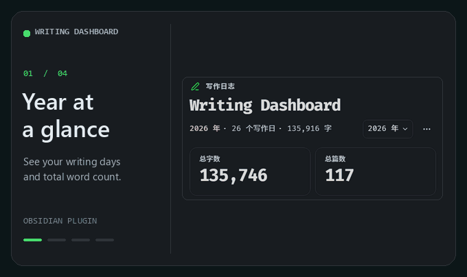

<div align="center">
  <p><a href="README.zh-CN.md">简体中文</a> · <strong>English</strong></p>
  <h1>Writing Dashboard</h1>
  <p><strong>See your writing activity without leaving Obsidian.</strong></p>
  <p>Yearly heatmap · Monthly trends · Live word counts</p>
  <p>
    <a href="https://github.com/Ckxkx/writing-dashboard/releases/latest"></a>
    
  </p>
  
  <p><a href="https://raw.githubusercontent.com/Ckxkx/writing-dashboard/main/docs/media/writing-dashboard-demo.mp4">Download the MP4</a> · <a href="#installation">Install</a> · <a href="#usage">Usage</a> · <a href="#development">Development</a></p>
</div>

---

Writing Dashboard is a local writing statistics plugin for Obsidian. It shows a yearly heatmap, daily note activity, and monthly word counts in the right sidebar.

## Features

| Feature | What it shows |
| --- | --- |
| Yearly overview | Switch years to see writing days and cumulative words. The totals at the top describe the Markdown notes currently included in your vault. |
| Writing heatmap | Opens on today. Hover over a date for statistics, then click it to see and open its notes. Keyboard navigation is supported. |
| Monthly trends | Compare the word counts recorded for each month of the selected year. |
| Live statistics | Preview changes as you type; Obsidian confirms them on save. The desktop status bar shows today's note and word counts and toggles the dashboard. |
| Local index | Import selected Markdown files or folders, exclude paths, change the counting rules, or pause tracking. |

## Installation

Requires **Obsidian 1.8.7 or later**.

1. Download main.js, manifest.json, and styles.css from [GitHub Releases](https://github.com/Ckxkx/writing-dashboard/releases/latest).
2. Put all three files directly in the writing-dashboard folder under .obsidian/plugins/ inside your vault. If you use a custom configuration folder, use it instead of .obsidian.
3. Restart Obsidian and enable **Writing Dashboard** under **Settings → Community plugins**.

To upgrade, replace all three files together and keep data.json. You do not need Node.js or Git to use the plugin.

## Usage

1. Click the ribbon icon or the desktop status-bar count, or run **Writing Dashboard: Open dashboard**. Click the status bar again to close the open dashboard.
2. Choose a year or select a date to see its notes. Scroll the heatmap left for earlier dates; use the Today button (`今天` in the screenshots) to return.
3. To import older notes, open the plugin settings and enter individual Markdown paths or folders under **补录旧笔记** (Import older notes), one per line. Choose **保存并重建** (Save and rebuild). The Vault root is not an import target. **··· → Rebuild index** refreshes known notes and these saved selections. On mobile, if no scope is saved, this opens the import prompt. You can also long-press a note or folder in the file explorer and choose **补录写作统计** (Import into writing statistics).

<details>
<summary>View the full dashboard</summary>


</details>

## How counting works

- **Vault totals** reflect the number of included Markdown notes and the length of their current body text. Deleting text reduces the vault's word count.
- **Daily and monthly counts** combine indexed text from existing notes with confirmed additions after the plugin is enabled. Indexed text uses the note's date; new additions use the local editing date. Each note counts once per day. A day with a positive word count counts as a writing day.
- **Existing notes** use the file's creation time first and fall back to the YAML `created` field if the timestamp is missing, invalid, or in the future. If neither date works, the note still contributes to vault totals. The index cannot reconstruct what you actually wrote each day before installing the plugin.
- Each Han character counts as one unit. Other words and continuous runs of digits count as one unit each. YAML, code blocks, inline code, images, and embeds are excluded by default. Settings can include YAML or code blocks; inline code remains excluded.
- Preview counts are confirmed on save. Saving the same content twice does not count it twice. When only a positive net change can be confirmed, the dashboard shows that minimum and marks the change as partial. Deleting text does not subtract already confirmed additions from historical counts.

## Data and privacy

Writing Dashboard runs locally and does not send notes, statistics, or telemetry. Startup refreshes only notes already known to the plugin. It also tracks Markdown notes you open, create, or edit. A manual import scans only the Markdown files or folders you select, and skips excluded paths. The totals cover those known and imported notes. Upgrading preserves existing statistics. Settings and statistics are stored in your vault's `.obsidian/plugins/writing-dashboard/data.json`. This file contains note paths and counts, but no note bodies. Quit Obsidian before backing it up. Rebuilding on one device does not transfer daily history from another device. The plugin does not merge statistics written concurrently by multiple devices.

## Development

Use Node.js 22:

```sh
npm ci
npm run check
npm test
npm run build
```

The build generates `main.js`. Run `npm run dev` to rebuild on changes. [Changelog](CHANGELOG.md) · [Third-party notices](THIRD-PARTY-NOTICES.txt)

For [bug reports](https://github.com/Ckxkx/writing-dashboard/issues), include the plugin version, Obsidian version, operating system, and steps to reproduce. Do not share your entire vault or `data.json`.


## License

[Apache License 2.0](LICENSE). The compiled plugin includes the license text and third-party notices.
