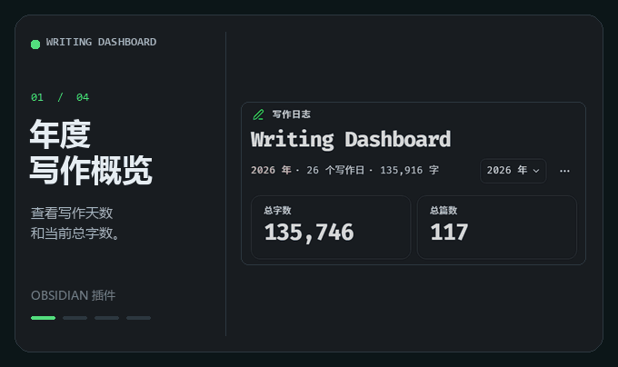
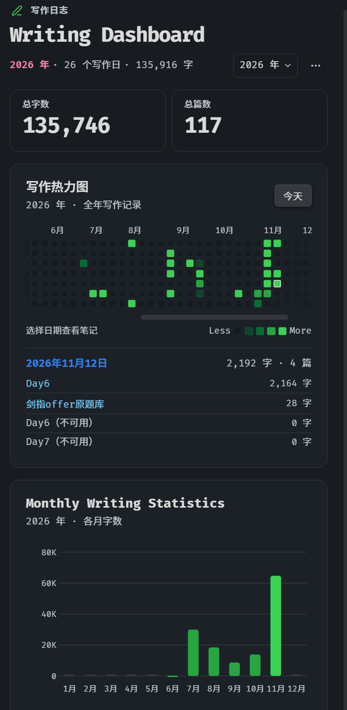

<div align="center">
  <p><strong>简体中文</strong> · <a href="README.md">English</a></p>
  <h1>Writing Dashboard</h1>
  <p><strong>在 Obsidian 右侧栏，查看每天的写作进度。</strong></p>
  <p>年度热力图 · 月度字数趋势 · 实时统计</p>
  <p>
    <a href="https://github.com/Ckxkx/writing-dashboard/releases/latest"></a>
    
  </p>
  
  <p><a href="https://raw.githubusercontent.com/Ckxkx/writing-dashboard/main/docs/media/writing-dashboard-demo-zh.mp4">下载 MP4 演示</a> · <a href="#安装">安装</a> · <a href="#使用">使用</a> · <a href="#开发">开发</a></p>
</div>

---

## 功能一览

| 功能 | 说明 |
| --- | --- |
| 年度概览 | 切换年份查看写作天数和累计字数。顶部总字数与总篇数反映当前纳入统计的笔记。 |
| 写作热力图 | 打开时定位到今天；悬停查看数据，点击日期查看并打开当天的笔记。支持键盘导航。 |
| 月度趋势 | 比较所选年份各月累计计入的字数。 |
| 实时统计 | 编辑时预览，Obsidian 保存后确认。桌面状态栏显示今日篇数和字数，点击可展开或收起仪表盘。 |
| 本地索引 | 可补录指定的 Markdown 笔记或文件夹、排除路径、调整计数规则，也可暂停追踪。 |

## 安装

需要 **Obsidian 1.8.7 或更新版本**。

1. 从 [GitHub Releases](https://github.com/Ckxkx/writing-dashboard/releases/latest) 下载 main.js、manifest.json 和 styles.css。
2. 将三个文件直接放进 Vault 的 .obsidian/plugins/writing-dashboard/ 目录。如果使用自定义配置目录，请替换 .obsidian。
3. 重启 Obsidian，在 **设置 → 第三方插件** 中启用 **Writing Dashboard**。

升级时同时替换三份文件，保留 data.json。使用插件无需安装 Node.js 或 Git。

## 使用

1. 点击左侧折线图图标或桌面底部的今日统计，也可运行 **Writing Dashboard: Open dashboard**。再次点击底栏可收起正在显示的仪表盘。
2. 选择年份或点击日期查看笔记。向左滚动热力图可查看更早的记录，点击「今天」返回。
3. 要补录旧笔记，进入插件设置的 **补录旧笔记**，每行填一个 Markdown 文件或文件夹路径，再点击 **保存并重建**。不接受 Vault 根目录。「··· → 重建索引」会刷新已记录的笔记和已保存的补录范围。手机尚未设置范围时，会打开补录对话框。也可在文件列表长按笔记或文件夹，选择「补录写作统计」。

<details>
<summary>查看完整仪表盘截图</summary>



</details>

## 统计规则

- **总字数与总篇数**是当前纳入统计的 Markdown 正文字数和笔记数量；删除文字会减少总字数。
- **每日与每月字数**合并两类数据：旧笔记已有正文按索引日期计入，之后确认的新增内容按本地编辑日期计入。同一天的同一篇笔记只计一次；有正数计入字数的日期计为一个写作日。
- **笔记归档日期**默认优先取有效的 YAML created，缺失、无效或在未来时回退到本机文件创建时间。可在设置中恢复文件时间优先。已索引的笔记改了日期后，可重建索引。两者都无效时，笔记仍计入总量，但不归到某一天。
- 汉字逐字计数，英文等非汉字文本按单词计数，连续数字算一个单位。默认不计 YAML、代码块、行内代码、图片和嵌入；设置可开启 YAML 和代码块计数，行内代码和 created 日期始终不计。
- 输入时显示的字数在保存后确认，相同内容不会因重复保存而重复计数。如果只能确认正的净增长，界面会显示至少新增了多少字，并保留「未完整计量」标记。删除内容不会扣减已确认的累计新增字数。

## 跨设备的创建日期

新建并打开空白 Markdown 笔记时，插件默认写入本地日历日期作为 created 属性。已有值会保留，不批量改写旧笔记，也不会给同步来的有内容笔记补写日期。使用带正文的 Obsidian 模板时，可在模板属性中加入 created: "{{date:YYYY-MM-DD}}"。自动填写和日期优先级可分别在设置中关闭。

有效的 created 会随笔记正文同步，电脑与手机归档时无需依赖各自的文件时间。这不会合并各端的逐日编辑记录，也不会同步补录范围。

## 数据与隐私

插件在本地运行，无需账户或服务器，不发送笔记或统计，也不收集遥测。启动只刷新插件已知的笔记；之后追踪你打开、新建或编辑的 Markdown 笔记。手动补录只扫描选定的文件或文件夹，并跳过排除的路径。总量以这些已纳入的笔记为准，升级会保留已有统计。设置与统计存放在 Vault 的 `.obsidian/plugins/writing-dashboard/data.json`，包含笔记路径和字数，不包含笔记正文。备份时建议先退出 Obsidian；重建索引不会从另一台设备传入逐日记录；插件也不会合并多台设备同时写入的统计文件。

## 开发

使用 Node.js 22：

```sh
npm ci
npm run check
npm test
npm run build
```

构建生成 `main.js`；`npm run dev` 会监听改动并重新构建。[版本记录](CHANGELOG.md) · [第三方依赖许可](THIRD-PARTY-NOTICES.txt)

遇到问题？请在 [GitHub Issues](https://github.com/Ckxkx/writing-dashboard/issues) 附上插件版本、Obsidian 版本、系统和复现步骤，无需上传整个 Vault 或 `data.json`。


## 许可证

[Apache License 2.0](LICENSE)。构建产物包含许可证全文及第三方依赖许可。
